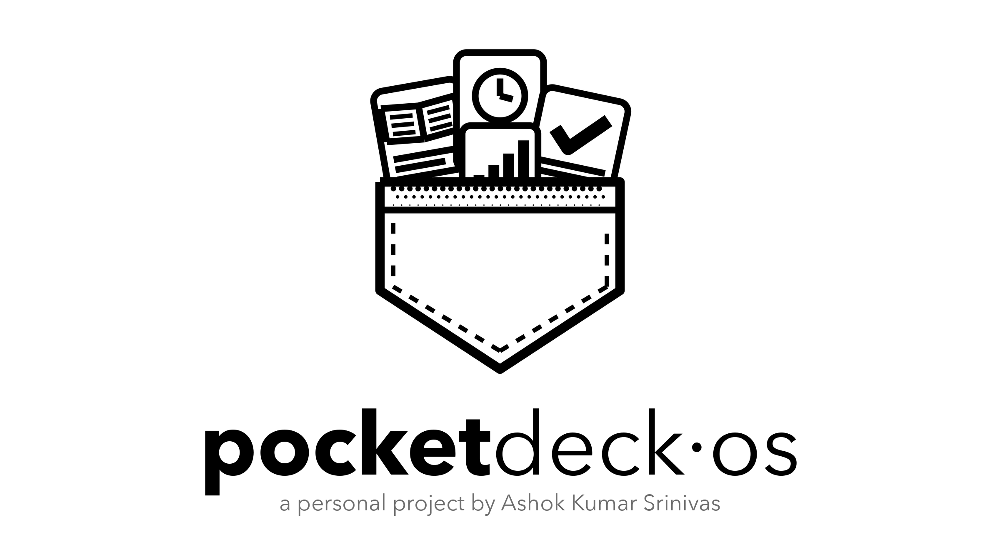
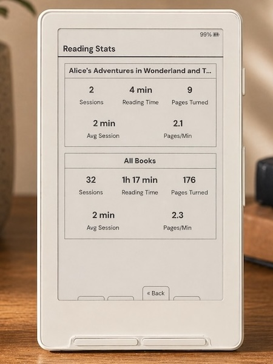

<p align="center">
  
</p>

# PocketDeck-OS

**A personal project by Ashok Kumar Srinivas** · version 1.0.0 · built on [CrossInk](https://github.com/uxjulia/CrossInk) (open source)

PocketDeck-OS is e-reader firmware for the Xteink X3 that keeps a calm,
book-first reader in your pocket and adds a small deck of daily tools, a real
file manager and a speed-reading pacer, all offline and all on the SD card.

## What's new

- **Speed Read**: a 4 px pacing underline glides under each phrase while the page turns by itself. Presets for English (125 / 200 / 275 / 350 WPM) and Kannada (60 / 100 / 150 / 200 / 250 / 350 WPM), picked automatically for the book; Left/Right fine-tune the pace by 10 WPM while reading (40–600).
- **Prepare books ahead**: Prepare Whole Book (reader menu) lays out every chapter so page turns are instant; Prepare Folder (Explorer) and Prepare Library (Settings) get book info and folder lists ready for big libraries. Each shows a progress bar, time left and the time it should finish. Clear Prepared Data frees that space and keeps your progress.
- **Built for huge libraries**: tested with 20,000+ books; book caches are sharded so 40,000+ stay fast, big folders open instantly from a saved list, and the SD layer remembers recently opened books.
- **Image zoom**: View Images zooms to 2x and 3x and steps through the picture a screenful at a time.
- **File manager in Explorer**: hold Open on any file or folder to Rename, Move, Copy (with a progress bar), Delete, see Info, or create a New folder. Reading progress, stats, bookmarks and highlights move with a book.
- **Back takes you where you came from**: a book opened from Explorer returns to its folder with the book highlighted; books opened from Home or Recent Books return Home.
- **SD card space** in Info ("12.3 GB free of 29.7 GB"), and Copy checks the space before it starts.
- **PocketDeck Home dashboard**: Now Reading, Recent Books covers, a weekly reading grid with streak, and an icon bar led by Explorer and Tools.

The full history is in [CHANGELOG.md](CHANGELOG.md).

## Features

### Reading

- **Speed Read** (reader menu, right after Look Up Word, with or without a dictionary). Long words and punctuation get a little more time; the bar sits between lines so it never covers descenders, ottaksharas or vowel signs, and only the bar refreshes as it moves.
  - Confirm pauses or resumes, Left/Right change the pace by 10 WPM, Back stops, and the side buttons still turn pages.
  - The status bar shows "Speed 200 WPM · Chapter" or "Paused · 200 WPM".
  - A short welcome card opens it. After 25 minutes it asks "Continue speed reading?"; with no answer in 10 seconds it ends and the normal sleep timer takes over. It also stops by itself after 2 minutes paused.
  - Pages are drawn in crisp black and white while it runs, so pacing starts at once. Expect a bit more battery use than ordinary reading.
- **Books in Kannada, Japanese, Russian, Spanish and more.**
  - Kannada EPUB/TXT books are shaped with the SD card Kannada font, sized to match the reader font.
  - Japanese, Chinese and Korean books use the included Noto Sans CJK font; Latin and Cyrillic use the built-in fonts.
  - Any `.cpfont` family can be added in `/fonts`.
- **View Images**: the page's pictures full-screen in grayscale, one at a time.
- **Search in Book**: find any word or phrase (typed or pasted, English or Kannada) and jump to the exact page, with the match underlined.
- **Copy Text and paste**: select words in a book (reader menu > Copy Text) and paste them into any text field (hold Down), such as Mood notes, Medicine courses or the Dictionary search. The last 50 copies are kept.
- **Kannada dictionary**: Look Up Word on a Kannada word goes to an installed Kannada dictionary even when the book's dictionary is English, and words are reduced to their dictionary form (ಹಕ್ಕಿಗಳ → ಹಕ್ಕಿ).
- **Hyphenation** for English, Russian and Spanish books; other languages wrap whole words.
- **Reading Stats**:
  - Every book gets a progress ring, a start-to-finish timeline, a time-of-day dial that names your busiest period, and day-of-week columns.
  - Library and device dashboards cover all books.
- **Sleep screens** include Book Reading Stats, **Weekly Reading Stats** (days read, time per day, books in progress, reading pattern), wallpapers rotated from `/sleep`, and Kannada book titles.
- Everything else from CrossInk is kept as it was: bookmarks, highlights (clippings), Focus Reading, Guide Dots, Auto Page Turn, tilt page turn and per-book render modes.

### Power button

- Hold **2 s** and release to sleep; hold **4 s** for a Power popup with **Shut down** and **Restart**.

### Explorer (files and folders)

- **Options sheet** (hold Open for about 1 second; a "Hold Open: options" tip shows at the bottom of the list):
  - **Files**: Rename · Move to… · Copy to… · Delete · Info, then the book extras (Mark finished, Delete cache, Delete stats, Render mode, Reset settings, Send to a nearby device).
  - **Folders**: Rename · Move to… · Copy to… · New folder here · Delete (the confirmation says how many items are inside) · Set as sleep folder · Info.
- **Move and Rename keep your reading**: progress, stats, bookmarks, highlights and Recent Books follow the book, including every book inside a moved folder.
- **Copy with a progress screen**:
  - It shows item n of m, a progress bar, and percent and MB copied, with Cancel.
  - It checks free space first, and a cancelled or failed copy removes everything it wrote.
  - Copying into the same folder makes "Name (copy)", and a copy never overwrites a file.
- **Search files…** (in the Options sheet): finds files and folders anywhere on the SD card by name; open a book straight from the results.
- **Info**: type, size, location, reading progress (or a folder's contents) and the SD card's free space.
- **Back-stacking**: from a book back to its folder, then up one folder at a time, then Home. This is remembered across sleep.
- PDF and MOBI files are listed, and opening one explains how to convert it.

### Home and look

- **PocketDeck theme dashboard**:
  - **Now Reading**: the book you're reading, with Continue Reading.
  - **Recent Books**: four covers, with the selected title in the heading.
  - **Reading Stats card**: a weekly grid titled with this week's dates (e.g. "12 Oct – 18 Oct"), total time, streak and a ring of days read this week.
  - **Icon bar**: Explorer · Tools · Recent · Transfer · Settings · Stats.
- **100 recent books**: the newest 10 stay in memory and the rest live on the SD card, fetched ten at a time with "Older books" / "Newer books".
- Eight UI themes, including Lyra Carousel with per-book stats under the carousel.

### Daily tools (Home > Tools)

In this order: **Daily Quote**, **Panchanga**, **World Clock**, **Pomodoro**, **Dictionary**, **Mantras**, **Workout**, **Habits**, **Mood**, **Medicine**, **Stats & export**, **Today**, and **Bookmarks & Clippings**.

- **Daily Quote**: a big date first, favourites, and Kannada quotes drawn from the SD card font.
- **Panchanga**: offline, in **Kannada or English**, any date from **1976 to 2075** with a calendar picker; festival and holiday calendars you can layer from JSON on the SD card.
- **World Clock**: cities picked on the device from a built-in list; syncs the clock over WiFi.
- **Pomodoro**: a ring that drains clockwise and a focus-history stats page; it redraws once a minute to save battery.
- **Mantras**: today's mantra, the daily ritual sequence, 35 deities, ritual mantras and kavacha, with a japa counter and stats.
- **Workout**: pranayama with a breathing circle, Surya Namaskara and asanas, kettlebell / dumbbell / ab wheel / spin bike intervals with a rep counter, and Baduanjin, Tai Chi and other longevity practices. Each comes with stick-figure guides, Kannada names and beginner/advanced timings, and every session is saved with stats.
- **Habits**: up to 12 habits, added and renamed on the device, with streaks, a weekly graph and "what time do I usually do this" stats.
- **Mood**: a daily five-point check-in with notes, a history list, a 30-day graph, mood mix and trends.
- **Medicine & supplements**: time-bound courses ("3 a day for 4 days", before or after food) with adherence, missed doses, on-time rate, and start/stop/completion dates.
- **Stats & export**: every statistic is written to `/stats/<feature>/*.json`, plus book data (progress, bookmarks, clippings, look-ups) that you can restore on another card or device.
- **Today**: a to-do list.
- **Dictionary**: look up any word without a book, typed, pasted or picked from your recent copies. Kannada and English, with Switch to see the same word in another dictionary.
- **Bookmarks & Clippings**: everything you've saved, across all books.
- Every tool with history has a stats page with charts and an **Export** button.

### Transfer

- **WiFi File Transfer** in the browser: upload files or **whole folders**, by button or by dragging a folder. Subfolders are recreated, existing folders are merged into, and hidden files such as `.DS_Store` are skipped.
- USB serial transfer, Calibre wireless, and Nearby book and position sync between two devices (from CrossInk).

- **Install or update:** [INSTALLATION_GUIDE.md](INSTALLATION_GUIDE.md) (over CrossInk, first setup, and adding your own content)
- **Using the tools:** [docs/productivity-tools.md](docs/productivity-tools.md)
- **Every screen:** [screenshot walkthrough](docs/screenshots/README.md); Panchanga and Mantras only: [docs/screenshots/panchanga-and-mantras](docs/screenshots/panchanga-and-mantras/README.md); Workout: [docs/screenshots/workout](docs/screenshots/workout/README.md); book languages: [docs/screenshots/languages](docs/screenshots/languages/README.md)

It is built on [CrossInk](https://github.com/uxjulia/CrossInk), which is itself
a fork of [CrossPoint Reader](https://github.com/crosspoint-reader/crosspoint-reader).
All of CrossInk's reading, WiFi, OTA and file-transfer features are kept as they
are; the notes below describe them.


## Installing PocketDeck-OS

PocketDeck-OS ships as a single firmware image per device family, plus an
optional SD-card data pack for the tools.

| Device | Firmware file |
| --- | --- |
| Xteink X3 / X4 (ESP32-C3) | `dist/pocketdeck-os-x3.bin` (current, tested on the X3) |
| Seeed reTerminal Sticky (ESP32-S3) | `dist/pocketdeck-os-sticky.bin` (older build from 5 Oct 2026, before 1.0's Home dashboard; build from source for the latest) |
| Xteink X4 Pro (ESP32-S3) | `dist/pocketdeck-os-x4-pro.bin` (older build from 5 Oct 2026; build from source for the latest) |

> Your books, reading progress, bookmarks and settings live on the SD card and
> are kept when you switch firmware. PocketDeck-OS keeps its reader data in
> `/.pocketdeck-os` and moves an existing CrossInk `/.crosspoint` folder there
> on first start (see [INSTALLATION_GUIDE.md](INSTALLATION_GUIDE.md#what-is-kept)). Charge the reader first and keep it
> plugged in while flashing.

### Option A: SD card (already running CrossInk or PocketDeck-OS)

1. Copy the `.bin` file for your device anywhere on the SD card.
2. On the reader open **Settings > System > SD Card Firmware Update**.
3. Pick the `.bin` file and confirm. The reader checks the image (size, chip
   and board) before writing, then restarts into PocketDeck-OS.

### Option B: USB with esptool (any firmware, including stock Xteink)

1. Install esptool: `pip3 install esptool`
2. Connect the reader with USB-C and find its port: `ls /dev/cu.*` on macOS
   (for example `/dev/cu.usbmodem2101`) or `dmesg | grep tty` on Linux
   (for example `/dev/ttyACM0`).
3. Optional but recommended: back up the current firmware (16 MB flash):

   ```sh
   esptool.py --chip esp32c3 --port /dev/cu.usbmodem2101 read_flash 0x0 0x1000000 backup-before-pocketdeck.bin
   ```

4. Flash PocketDeck-OS to the first app slot, and clear `otadata` so the reader
   boots that slot even if it previously installed an over-the-air update:

   ```sh
   esptool.py --chip esp32c3 --port /dev/cu.usbmodem2101 --baud 921600 write_flash 0x10000 dist/pocketdeck-os-x3.bin
   esptool.py --chip esp32c3 --port /dev/cu.usbmodem2101 erase_region 0xe000 0x2000
   ```

   For the ESP32-S3 devices use `--chip esp32s3` and the matching `.bin`.
5. Press the reset or power button. The PocketDeck-OS boot screen appears.

To go back, flash your backup with
`esptool.py --chip esp32c3 --port <port> write_flash 0x0 backup-before-pocketdeck.bin`.

### Option C: build from source

```sh
pip install "platformio==6.1.18"
git submodule update --init --recursive
pio run -e default -t upload        # X3 / X4
```

The project path must not contain spaces (an ESP-IDF limitation). The image is
also written to `.pio/build/default/firmware-x3-x4.bin`.

### After installing

1. Copy `sd-sample/tools` (and optionally `sd-sample/sleep`) to the root of the SD card for sample quotes,
   habits, mantras, workouts, Panchanga data and wallpapers (see [sd-sample/README.md](sd-sample/README.md)).
   The sample's `flashcards` and `knowledge` folders are no longer used and can be skipped.
2. Set your time zone in **Settings > System > Device > Clock UTC Offset**, then
   open **Home > Tools > World Clock** and press **Confirm** to sync the clock over WiFi.
3. Optional: add a StarDict dictionary under `/.dictionaries/` for word lookup
   ([docs/dictionary.md](docs/dictionary.md)).

## Adding your own content (SD card)

Everything the tools read lives in `/tools` on the SD card. Edit these files on
a computer (or upload them with **Home > File Transfer**) and reopen the tool;
indexes rebuild automatically when a file changes.

### Daily quotes: `/tools/quotes.txt`

One quote per line:

```
2026-12-25|Peace begins with a smile. — Mother Teresa
01-01|A new year every year on 1 January — Author
*|Only used for random picks — Author
```

`YYYY-MM-DD` shows on that date, `MM-DD` every year, `*` has no date and only appears as a random pick (random picks come from the whole file).
Text after ` — ` is the author. Very long quotes page with Up/Down (up to 2,048 bytes per line; longer lines are cut off).

### Habits: `/tools/habits/habits.txt`

Easiest: in **Habit Tracker**, press **Left (Menu)** and choose **Add a new habit**,
**Rename** or **Delete**. Up to 12 habits. Or edit the file, one habit per line:

```
Water
Yoga
Workout
Tender coconut water
```

History is matched by name, so adding, removing or reordering lines keeps your
ticks. Renaming on the device carries the last year of ticks to the new name
(renaming in the file starts it fresh). Every tick is also logged with its time
in `/tools/habits/log-YYYY-MM.txt`, which is where "Usual time", "Time
consistency" and "Average gap" come from.

### Medicine: `/tools/medicine/courses.txt`

Add courses on the device (Medicine > Confirm, or Left (Menu) > Add a course):
name, doses a day, before/after food, length and start, then a summary such as
"Starts Mon Sep 28, ends Thu Oct 1. 3 a day: … After food. 12 doses in all."
Or one per line in the file:

```
# id|name|doses per day|days|start|stopped or -|dose times|food (before/after/with/-)
c1|Paracetamol 500 mg|3|4|2026-09-27|-|08:00,13:00,19:00|after
c2|Vitamin D3|1|30|2026-09-08|-|08:30|with
```

Ids can be any short word without `|`. Each tick is logged in
`/tools/medicine/log-YYYY-MM.txt`.

### Other settings

| File | What you can change |
| --- | --- |
| `/tools/worldclock.txt` | Cities (max 6): name, UTC offset and DST rule (US, EU, AU, NZ or NONE), separated by `\|`. On the device: World Clock > Left (Cities) |
| `/tools/pomodoro.txt` | `focus=25` and `break=5` minutes |
| `/tools/panchanga.txt` | `lat=`, `lon=`, `tz=` for your town (default Bengaluru), `animate=0/1`, `lang=kn` or `lang=en` (or Panchanga > Confirm (Menu)) |
| `/tools/daily.json` | Today's to-do list (also editable on the device) |
| `/tools/quotes/favorites.txt` | Favourite quotes (Daily Quote > Menu > Save as favourite) |
| `/sleep/` | Wallpapers (`.bmp`, `.jpg`); Settings > Display > Sleep Screen > Change wallpaper |

Stats for every feature are exported by **Tools > Stats & export** to
`/stats/<feature>/`; see [docs/productivity-tools.md](docs/productivity-tools.md#stats--export).

> **Updates:** **Settings > System > Check for Updates** still checks the
> upstream CrossInk release feed. Accepting an update from there replaces
> PocketDeck-OS with stock CrossInk. Update PocketDeck-OS by installing a newer
> PocketDeck-OS `.bin` with Option A or B.

---

> **CrossInk (the base of PocketDeck-OS) is a personal fork of [CrossPoint Reader](https://github.com/crosspoint-reader/crosspoint-reader)** with a focus on improved fonts and minimal reading stats.

### Supported Devices

- Xteink X3
- Xteink X4
- Xteink X4 Pro
- Xteink X4 Classic
- Seeed Studio Sticky

## What's different in this fork

My goal with this fork was to maintain the core Crosspoint firmware while integrating my preferred typography and some lightweight reading statistics. I’ve focused on keeping the underlying system stable while layering in a few "nice-to-have" features and UI refinements along the way.

<table>
  <tr>
    <td align="center">
      <br/>
      <em>Font: Bitter, Size: 12 pt, Margin: 15</em>
    </td>
    <td align="center">
      <br/>
      <em>Reading Stats with custom front button mapping shown</em>
    </td>
  </tr>
</table>

### Highlights

- New reader fonts: Lexend Deca and Bitter.
- Music notation and selected supplemental Unicode glyph support to be able to render Project Hail Mary accurately.
- Added a custom `Minimal` theme and sleep screen option for the minimalists out there.
- Added a custom `Dashboard` theme and sleep screen option for reading stats enthusiasts.
- Reader font sizes: 10 pt, 12 pt, 14 pt, and 16 pt.
- Added ~~strikethrough~~ support.
- Made <u>underlines</u> thicker for better visibility.
- Added support for `<hr>` section breaks.
- Added support for "redaction" style rendering.
- Added improved support for tables with simple markup.
- Added ability to add bookmarks.
- Added ability to remap front buttons that only applies in the reader.
- Added Focus Reading and Guide Dots as optional reader modes.
- Added Force Paragraph Indents for books that render as one giant wall of text.
- Added ability to pin a sleep image as a favorite. The favorited image will always be displayed when your sleep settings are set to `Custom` or `Cover + Custom` (when no cover is available).
- Added more in-reader control remapping options for side buttons, short power button clicks, and long-press menu actions, and more.
- Added ability to mark a book as finished from the in-book menu. A pop-up will also display once 99% of the book is reached. This status allows tracking of total books read.
- Added ability to move finished books to "Read" folder.
- In-book menu to quickly adjust reader options without having to exit the book.
- Reading stats: total books read, total reading time, number of sessions, pages turned, average session time, pages turned per minute. You can also set your reading stats as your sleep screen.
- All-time reading stats [syncing](./docs/reading-stats-sync.md) between two CrossInk devices.
- Reading [progress sync](./docs/nearby-position-sync.md) between two CrossInk devices.
- Added customizable Auto Page Turn Interval (anything between 5-120 seconds).
- Added ability to view Recent Books as a 3x3 grid view.
- To view a more detailed list for each version, visit the [releases](https://github.com/uxjulia/CrossInk/releases) page to read release notes.

---

### Reader Fonts

The default fonts have been replaced with Lexend Deca and Bitter. These fonts have been chosen specifically to improve reading fluency and e-ink performance. These 'sturdier' typefaces feature uniform stroke weights and open geometries, allowing the X4/X3 to render crisp, high-contrast text with font-aliasing on while significantly reducing ghosting and artifacts.

- [Lexend Deca](https://fonts.google.com/specimen/Lexend+Deca) - A research-backed sans-serif typeface designed to improve reading fluency. Lexend was engineered based on the theory that reading issues are often a design problem (visual crowding) rather than a cognitive one.
- [Bitter](https://fonts.google.com/specimen/Bitter) - A "contemporary" slab serif typeface for text, it is specially designed for comfortably reading on digital screens. The consistent stroke weight of Bitter helps it render particularly well on e-ink devices. The medium weight has been chosen specifically for improved rendering on the X4/X3.

The UI now uses [Inter](https://fonts.google.com/specimen/Inter) as the display font which has improved readability at smaller sizes.

### Music and Supplemental Glyphs

- Built-in reader fonts include music notation, selected Cyrillic glyphs, and the Project Hail Mary CJK fallback ranges. Additional SD-card fonts retain emoji fallback support.

---

### Font Sizes

CrossInk includes 10 pt, 12 pt, 14 pt, and 16 pt built-in reader font sizes.

See [SD Card Fonts](./docs/sd-card-fonts.md) for installing additional font families and size ranges.

---

### Reader features

Reader Options, Focus Reading, Guide Dots, Force Paragraph Indents, reading stats, and finished-book behavior are documented in [Reader Features](./docs/reader-features.md).

### Custom button actions

CrossInk adds configurable button shortcuts.

See [Controls](./docs/controls.md) for the full action list and defaults.

---

## Tips for the best reading experience

CrossInk runs on an ESP32-C3 with limited RAM, so very large folders or complex EPUBs can be slower than they would be on a phone, tablet, or desktop app.

- Keep folders under about 200 files. For the smoothest browsing, aim for 50-100 files per folder.
- Having 1000+ books on the SD card is fine if they are split into smaller folders, such as by author, series, genre, or read/unread status.
- Avoid putting every book in the SD card root. The file browser has to scan and sort the current folder before it can show it.
- Text-first EPUBs are the best fit. Large image-heavy EPUBs, scanned books, comics, and omnibus files with thousands of sections may load slowly or fail under memory pressure.
- As a rough target, EPUBs under 20 MB tend to work the best. Files over 50 MB may still work, but they are more likely to be slow or memory-sensitive, especially if they contain many large images.
- **Indexing Method** (Reader settings): *Full Section* (default) builds each chapter once and pre-builds the next chapter while you read, so page turns and chapter changes are instant. *Incremental* shows a new font or margin setting sooner but builds the next chapter only when you reach it. Pick the one you notice more.
- If an EPUB is unusually slow, try [optimizing](./docs/webserver.md#epub-optimization) it with the built-in web optimizer (via File Transfer) before copying it to the SD card: remove unused high-resolution images, split very large omnibus files, and avoid embedding multiple full font families when possible.
- Use a reliable SD card and leave some free space. CrossInk stores settings, reading progress, cache files, stats, and generated book data on the card.

---

## Installing upstream CrossInk

> These steps install stock CrossInk, not PocketDeck-OS. For PocketDeck-OS see [Installing PocketDeck-OS](#installing-pocketdeck-os).

The fastest way to install Crossink is by using Inky, Crossink's web companion app: https://inky.crossink.dev/#flash-tools

Download a `firmware-*.bin` from the [releases page](https://github.com/uxjulia/CrossInk/releases), then flash it with the web installer or command line.

See [Installation](./docs/installation.md) for step-by-step flashing and revert instructions.

---

## Guides & Documentation

Visit [https://www.crossink.dev](https://www.crossink.dev) for more user guides and additional documentation.

Productivity tools (Home > Tools: Daily Quote, Panchanga, World Clock, Pomodoro, Mantras, Workout, Habits, Mood, Medicine, Stats & export, Today, Bookmarks & Clippings): see [docs/productivity-tools.md](docs/productivity-tools.md). A ready-to-copy SD card data pack is in [`sd-sample/tools`](sd-sample/tools).

---

## Development quick start

CrossInk uses PlatformIO for building and flashing firmware. See [Getting Started](./docs/development/getting-started.md) for prerequisites, clone setup, and validation commands.

### Nix/NixOS

Nix/NixOS users can enter the development shell with either `nix develop` (flakes) or `nix-shell`:

```bash
nix develop -f nix
# or
nix-shell nix
```

To flash a connected ESP32-C3 device, enable PlatformIO's udev rules in your NixOS configuration:

```nix
services.udev.packages = with pkgs; [ platformio-core.udev ];
```

After rebuilding the system configuration, reconnect the device or reload udev rules.

### Build / flash / monitor

Connect your device to your computer via a USB cable. Before the first build, initialize the repository's submodules (including `freeink-sdk`):

```sh
git submodule update --init --recursive
```

Then flash the firmware using the correct environment for the device. The `default` environment is for the X3/X4 devices. ESP32-S3 devices have their own named environments.

```sh
pio run -e default --target upload
```

If PlatformIO reports `PackageException: Can not create a symbolic link for freeink-sdk/libs/hardware/BatteryMonitor, not a directory`, the `freeink-sdk` submodule is not initialized. Run the submodule command above and retry.

See [Testing and Debugging](./docs/development/testing-debugging.md) for serial logging, simulator checks, static analysis, and bug-report guidance.

---

## Notice on Contributions

This repository does not accept pull requests. Feature requests may be opened in [discussions](https://github.com/uxjulia/CrossInk/discussions), but major features requiring ongoing support should be directed upstream to [CrossPoint](https://github.com/crosspoint-reader/crosspoint-reader).

---

If you'd like to show some love and support ongoing development, please consider supporting me on Ko-fi.

[](https://ko-fi.com/Q5Q01M6S7)
