# Book languages screenshots

Captured from the X3 simulator (528 x 792, portrait) with the sample SD card pack: the Kannada font
`tools/fonts/kannada.knf`, `fonts/NotoSansCJK` and the test books in `sd-sample/books`.
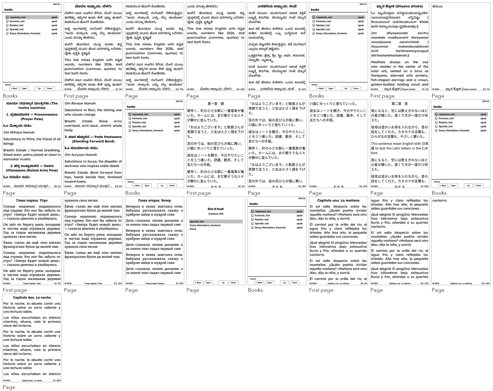

## Kannada (SD card Kannada font, shaped)

|  |  | 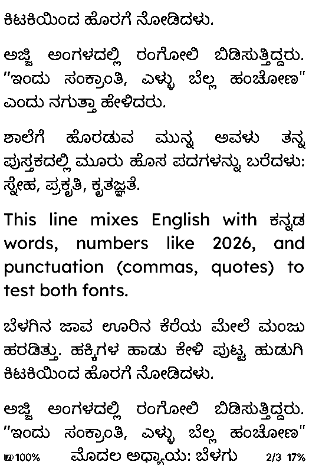 | 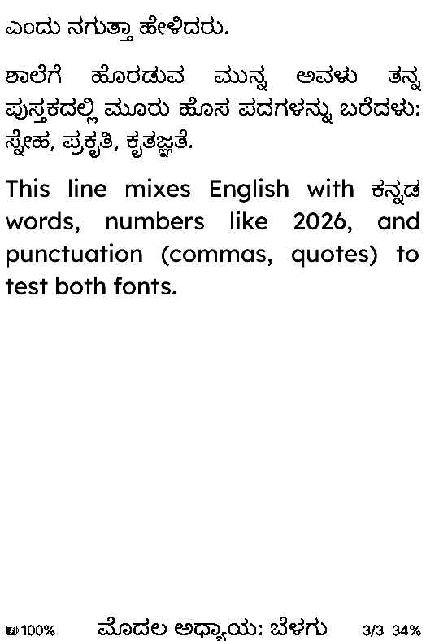 |
|---|---|---|---|
| Books | First page | Page | Page |

| 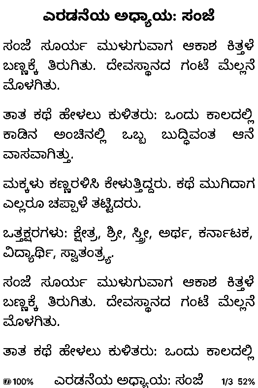 |
|---|
| Page |

## Kannada sample: Surya Namaskara mantras

|  |  | 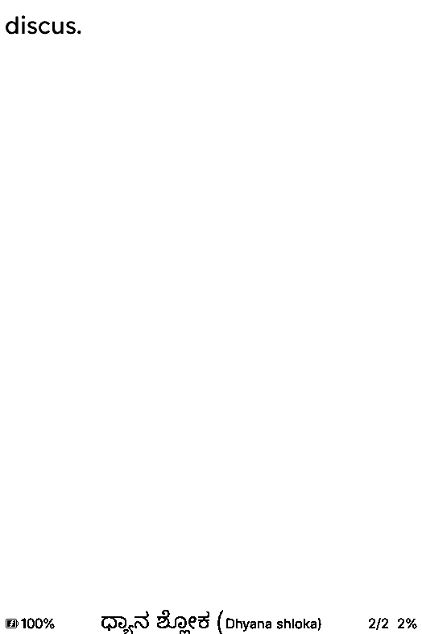 |  |
|---|---|---|---|
| Books | First page | Page | Page |

|  |
|---|
| Page |

## Japanese (NotoSansCJK from /fonts)

|  | 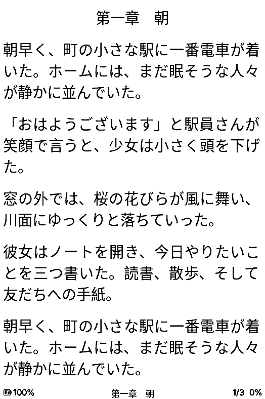 | 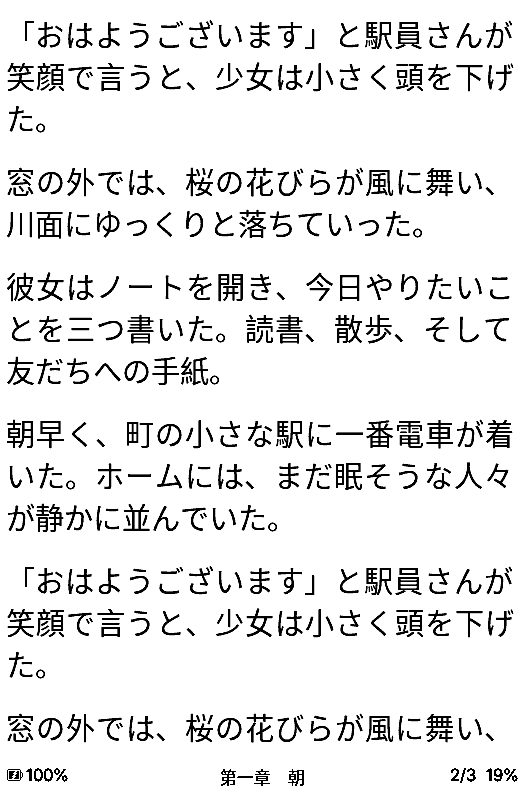 | 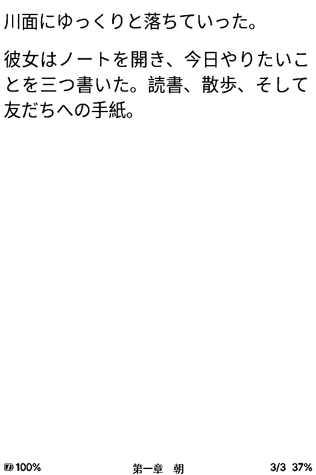 |
|---|---|---|---|
| Books | First page | Page | Page |

|  |
|---|
| Page |

## Russian (built-in font)

|  |  |  |  |
|---|---|---|---|
| Books | First page | Page | Page |

| 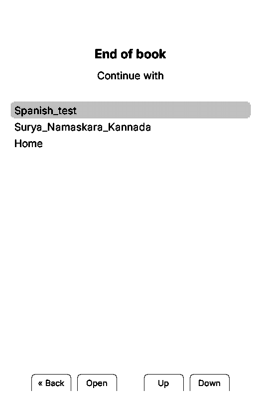 |
|---|
| Page |

## Spanish (built-in font)

| 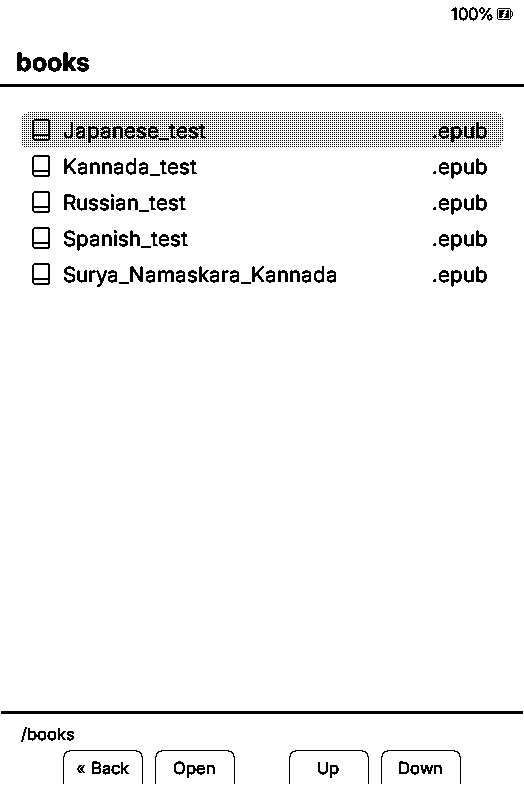 | 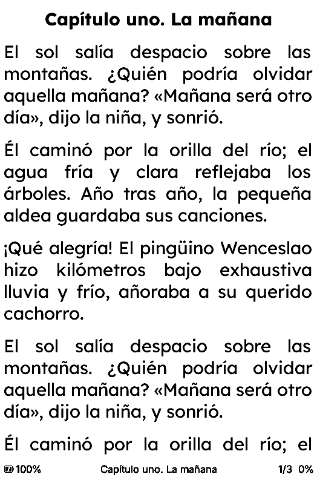 | 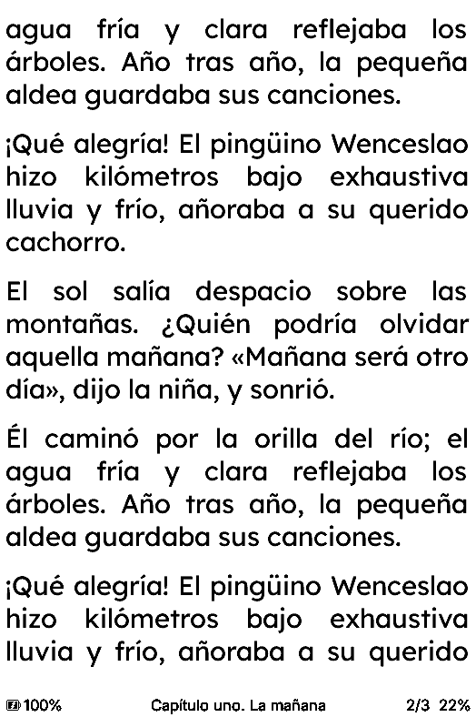 | 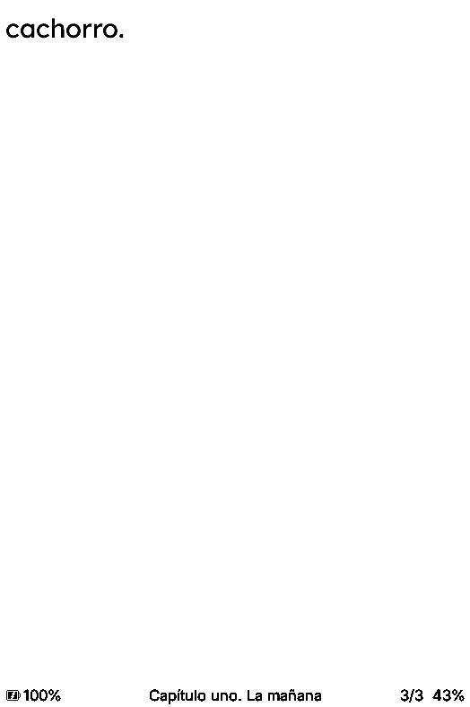 |
|---|---|---|---|
| Books | First page | Page | Page |

|  |
|---|
| Page |

